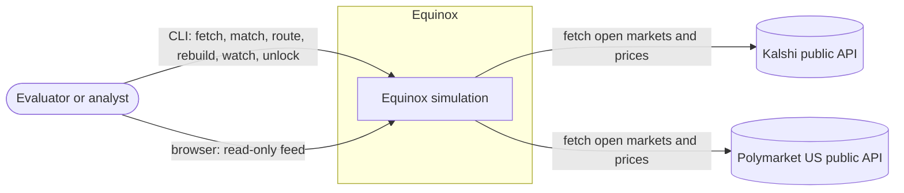
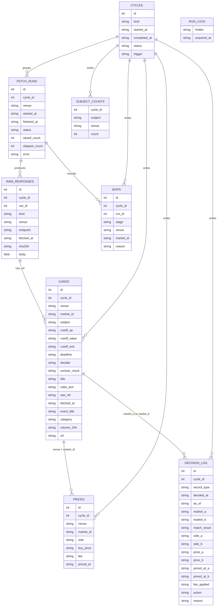
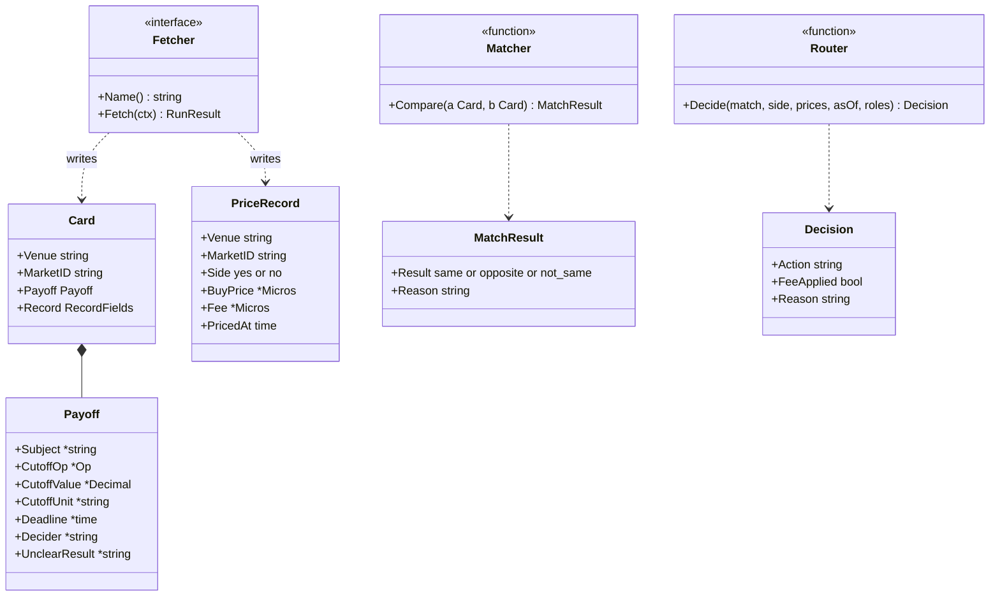
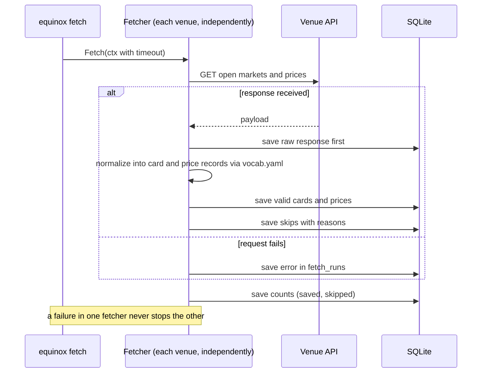
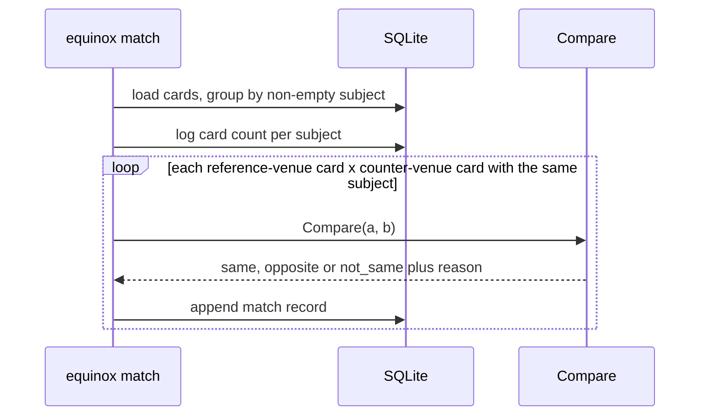
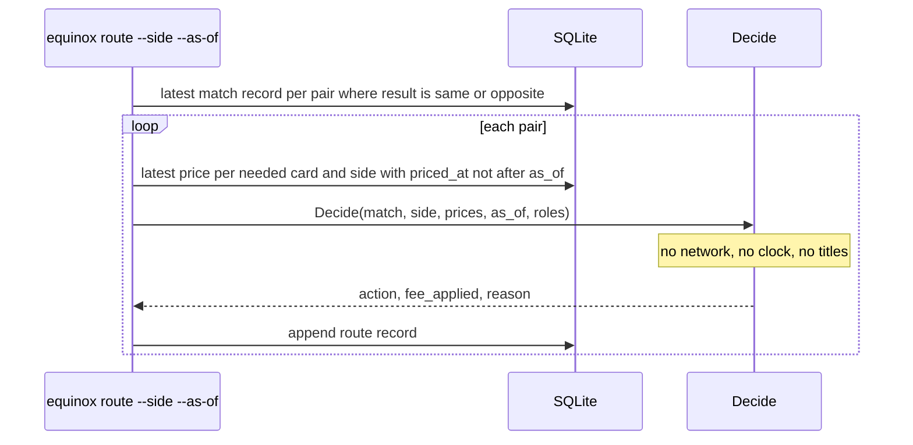
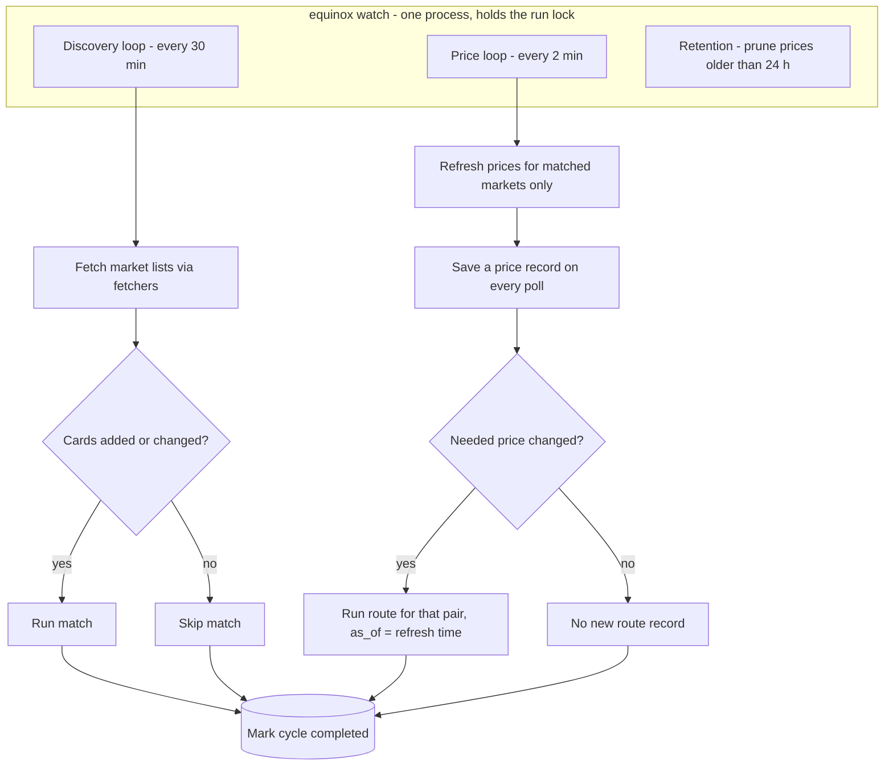
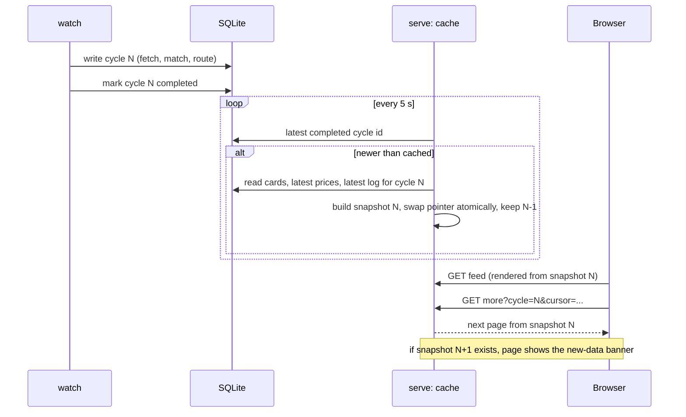

# Architecture

High-level design shows context and the four pieces. Low-level design shows the storage schema, the core types, and the runtime sequences. Diagrams are Mermaid and render on GitHub.

## Design principles
1. Four pieces run in order, and each reads only what earlier pieces saved. Only fetchers touch the network.
2. Venue knowledge lives only in fetchers. Matcher and router get venue roles from config, never from code.
3. Empty means unknown, and unknown never matches.
4. A refusal is a first-class outcome, logged exactly like a choice.
5. Bad data is skipped, counted and logged. It never stops a run and never reaches a decision.

## High-level design

### Context


### The four pieces
```mermaid
flowchart LR
  subgraph F[1 Fetchers]
    KF[Kalshi fetcher]
    PF[Polymarket fetcher]
  end
  V[(config/vocab.yaml)]
  subgraph DB[(SQLite)]
    RAW[raw_responses]
    CARDS[cards]
    PRICES[prices]
    RUNS[fetch_runs and skips]
    LOG[decision_log - append only]
  end
  M[2 Matcher]
  R[3 Router]
  FEED[4 Feed - read only]
  CFG[(config/equinox.yaml)]

  KF --> RAW
  PF --> RAW
  V --> KF
  V --> PF
  KF --> CARDS
  PF --> CARDS
  KF --> PRICES
  PF --> PRICES
  KF --> RUNS
  PF --> RUNS
  CARDS --> M
  M --> LOG
  LOG --> R
  PRICES --> R
  CFG --> R
  R --> LOG
  CARDS --> FEED
  PRICES --> FEED
  LOG --> FEED
  RAW -- "equinox rebuild" --> CARDS
```

| Piece | Reads | Writes | Network |
|---|---|---|---|
| Fetchers | venue APIs, vocab.yaml | raw_responses, cards, prices, fetch_runs, skips | Yes, the only piece |
| Matcher | cards | decision_log (match records) | No |
| Router | decision_log (latest match result per pair), prices, equinox.yaml, `as_of` | decision_log (route records) | No |
| Feed | in-memory snapshot of the latest completed cycle, built from cards, prices and decision_log | nothing | No |
| Watch (amendment A1) | venue APIs via fetchers, then the same match and route code | same as fetch, match and route, plus cycles and pruning | Yes, through fetchers only |

## Low-level design

### Storage schema

Every data row carries the cycle_id that wrote it, and readers see only completed cycles. Cards are versioned: a new row only when a card changes (assumptions A-5 to A-9; internal/store/schema.sql is the source). Empty payoff fields are stored as NULL. Prices and fees are stored as decimal strings and parsed into integer micro-dollars in Go. The log tables have no UPDATE or DELETE paths.

### Core types and boundaries

`Compare` and `Decide` are pure functions. Thin runners load from SQLite, call them, and append to the log.

### Sequence: fetch


### Sequence: match


### Sequence: route


### Sequence: rebuild
```mermaid
sequenceDiagram
  participant CLI as equinox rebuild
  participant DB as SQLite
  participant N as Normalizer (each venue)
  CLI->>DB: load saved raw responses
  CLI->>N: same normalization code path as fetch
  N-->>CLI: cards
  CLI->>DB: replace cards
  Note over CLI: no venue call; test 18 asserts identical cards
```

## Background refresh and feed cache (amendments A1 to A5)

### Watch loops


### Feed cache swap


Rules: the cache is built only from SQLite and only from completed cycles; it never calls a venue and never writes. Pages carry their cycle number so "Load more" finishes on the cycle the reader started with. The previous snapshot is kept for that reason.

## Key tradeoffs
| Choice | Gained | Given up |
|---|---|---|
| Exact payoff equality, no score | Zero tolerance for wrong-bet routing, fully explainable | Recall limited by vocabulary and fetcher rules |
| Shared vocabulary, one category in V1 | Equality is meaningful across venues | Narrow coverage until entries are added |
| Saved data only for match and route | Determinism, no blocking, auditability | Decisions use prices up to 10 minutes old |
| SQLite | Single file, queryable, zero setup | Single writer |
| One contract at the buy price | Simple, explainable | No size, depth or slippage |
| Venue roles in config | Router has no venue names | One more config file to keep correct |
| Feed from an in-memory snapshot | Fast scrolling, consistent point-in-time view | Up to one cache check interval behind SQLite; memory grows with market count |
| Background watch | Feed stays current without a person | Venue rate limits to respect; one more process to run |
